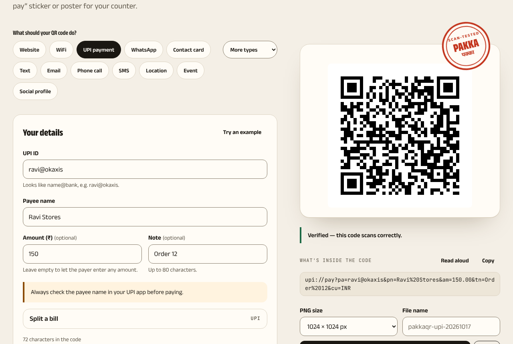
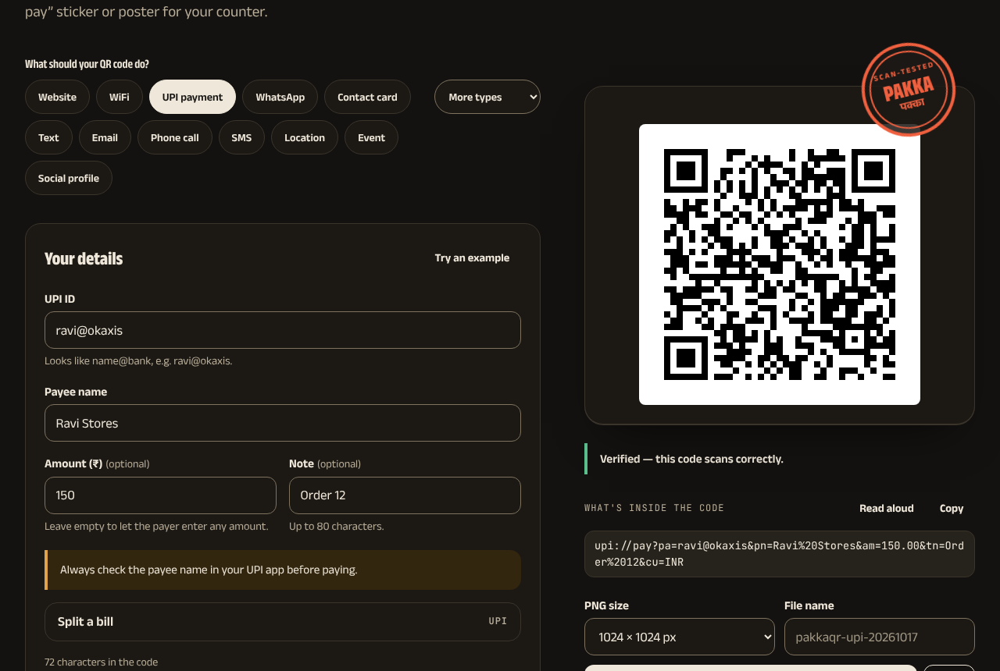
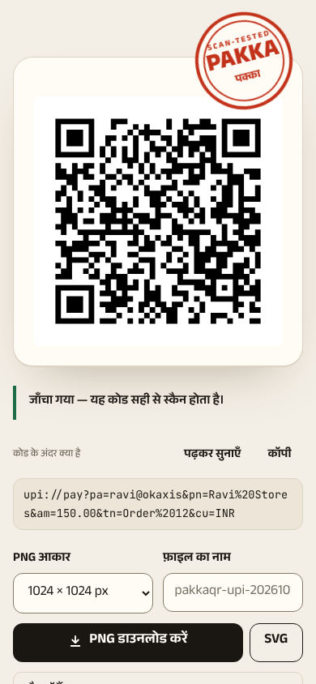

# PakkaQR

**QR codes that work. Pakka.** Free QR codes that never expire. No signup. No tracking. No watermark. Runs entirely in your browser.

[Live site](https://pakkaqr.pages.dev) · [Report a bug](../../issues/new?template=bug_report.md) · [Request a feature](../../issues/new?template=feature_request.md)



## Why

Many "free" QR generators create **dynamic** codes. The printed pattern holds _their_ short link, which redirects to yours, and stops working when the trial ends unless you pay. PakkaQR creates **static** codes: your data lives inside the code itself, so it works forever. Even if this website disappeared, your codes would keep working.

## Features

- **16 QR types:** website, text, WiFi, UPI payment, WhatsApp, phone, SMS, email, contact card (vCard), location, calendar event, social profiles (Instagram, YouTube, Facebook, LinkedIn, Telegram, X, TikTok, Threads, Snapchat, GitHub), app download, Google review, MeCard and crypto.
- **Paste anything:** one box that recognises links, UPI IDs, phone numbers, WiFi details and more, plus one-tap starters (link in bio, pay me, split the bill, guest WiFi, playlist, party invite).
- **Design:** colours, gradients, six dot styles, corner styles, your logo (or a built-in icon), nine frames including ticket, pill and round sticker, 18 presets, a Shuffle button that only makes scannable styles, and colours matched from your own photo.
- **Built-in scan test:** every change is rendered and decoded in the browser. A stamp shows PAKKA, RISKY or DOES NOT SCAN, with one-click fixes.
- **Downloads:** PNG (256–4096 px), SVG, PDF at an exact physical size, JPEG and WebP, plus copy to clipboard and the mobile share sheet.
- **Bulk generator:** CSV to a ZIP of PNGs/SVGs (plus an optional PDF), generated in a Web Worker, with a report for any bad rows.
- **Print layouts:** sticker sheets (2–10 cm), A4 table tents, posters, 10-up business cards and WiFi cards, as print-ready PDFs.
- **QR scanner** (camera, upload or paste) with safe link handling, and a **"Will my QR code expire?" checker**.
- **Share cards:** Instagram/WhatsApp story, post and square images, and a short animated video — all made on your device.
- **Personalise:** theme, stamp colour, Big & clear text, less motion and vibration.
- Saved designs, opt-in history and shareable style links. **English + हिन्दी**, light/dark theme, works offline (PWA).

| Dark mode                                                     | Mobile, in Hindi                                  |
| ------------------------------------------------------------- | ------------------------------------------------- |
|  |  |

## Privacy

Nothing you type or upload ever leaves your device: no cookies, no analytics, no third-party requests. Fonts and scripts are self-hosted and a strict Content-Security-Policy is set. You can check this yourself: open your browser's Network tab while you make a code, or read the code here. The full promise is on the site's Privacy page; design choices are in [docs/DECISIONS.md](docs/DECISIONS.md).

## Run locally

Requires Node.js 22.12+ (CI uses Node 24).

```bash
git clone https://github.com/theanwerfaiz/PakkaQR.git
cd PakkaQR
npm install
npm run dev
```

| Command                              | What it does                                                         |
| ------------------------------------ | -------------------------------------------------------------------- |
| `npm run dev`                        | Development server at http://localhost:4321                          |
| `npm run build`                      | Static site in `dist/` (icons, share images, pages, service worker)  |
| `npm run preview`                    | Serve the built site                                                 |
| `npm test`                           | Unit and round-trip tests (Vitest)                                   |
| `npm run test:coverage`              | Same, with coverage thresholds                                       |
| `npm run test:e2e`                   | End-to-end tests in Chromium (Playwright; run `npm run build` first) |
| `npm run test:e2e:all`               | End-to-end tests in Chromium, Firefox and WebKit                     |
| `npm run lint` / `npm run typecheck` | ESLint + Prettier / Astro + TypeScript checks                        |

Configuration lives in environment variables; copy `.env.example` to `.env`. All of them are optional.

## Deploy

The output is plain static files, so any static host works.

- **Cloudflare Pages (recommended):** build command `npm run build`, output directory `dist`, environment variable `NODE_VERSION=24`. Set `PUBLIC_SITE_URL` to your domain. Security headers come from `public/_headers`.
- **GitHub Pages:** enable _Settings → Pages → Source: GitHub Actions_. `.github/workflows/deploy-pages.yml` deploys after CI passes on `main`, using the repository name as the base path. Override it with the repository variables `PUBLIC_SITE_URL` and `PUBLIC_BASE_PATH`, for example when using a custom domain.
- **Netlify / Vercel:** build `npm run build`, publish `dist`.

## Contributing

New QR types, languages, presets, frames and redirect-domain entries are very welcome. See [CONTRIBUTING.md](CONTRIBUTING.md).

## Support

PakkaQR is free forever. If it helped you, ⭐ star the repo or sponsor the project (set `PUBLIC_SPONSOR_URL` to show the link on the site).

## License

[MIT](LICENSE) © 2026 Faiz Anwer

QR Code is a registered trademark of DENSO WAVE INCORPORATED. UPI is a trademark of NPCI. This project is not affiliated with either.
